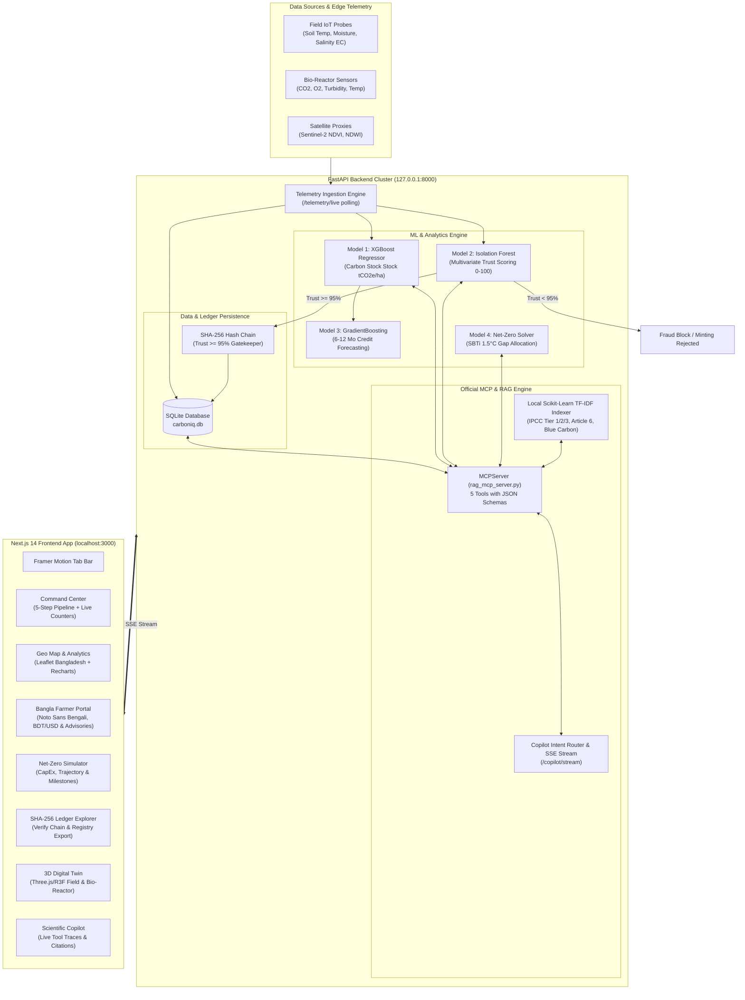

# CarbonIQ-MRV: AI-Powered Digital MRV & Net-Zero Intelligence Platform

> **ClimateSphere AI / CarbonIQ Challenge — Hackathon MVP**  
> *Transforming low-cost IoT telemetry and satellite proxy data into cryptographically verified Article 6 carbon credits, detecting sensor fraud with machine learning, and calculating corporate net-zero decarbonization pathways.*

---

## 🌟 Executive Overview

**CarbonIQ-MRV** is an end-to-end digital Measurement, Reporting, and Verification (dMRV) platform designed to eliminate the high costs, multi-month audit delays, and greenwashing risks inherent in traditional carbon offset schemes. 

By fusing continuous ground telemetry (soil probes, water quality sensors, microalgae photobioreactor chambers) with satellite vegetation proxies (Sentinel-2 NDVI & NDWI), CarbonIQ-MRV provides:
1. **Continuous Carbon Stock Inference**: Real-time calibration of soil organic carbon (SOC) and blue-carbon mangrove biomass stocks ($tCO_2e/ha$).
2. **AI Anti-Fraud & Anomaly Guard**: Multivariate Isolation Forest that detects sensor spoofing, tampering, and physical incoherence before credits are minted.
3. **Cryptographic SHA-256 Hash-Chain Ledger**: Immutable on-chain-ready blocks anchoring verified carbon increments (Trust Score $\ge 95\%$) with cryptographic continuity verification.
4. **SBTi-Aligned Net-Zero Pathway Solver**: Instant engineering roadmap balancing industrial microalgae photobioreactors, coastal mangrove restoration, CapEx budgeting, and payback timelines.
5. **Scientific Copilot with Official MCP Server**: Local RAG knowledge engine covering IPCC Tier 1/2/3 accounting guidelines, 2013 Wetlands Blue Carbon Supplements, and Paris Agreement Article 6 mechanisms.
6. **Bangla Farmer Portal & Mobile Advisory**: Localized interface in Noto Sans Bengali (with English toggle) displaying verified plot credits, transparent earnings in BDT (৳) and USD ($), dynamic soil/water advisories, and simulated SMS/Voice IVR alerts.

> [!NOTE]  
> **Synthetic Data Disclosure**: In compliance with hackathon rules, all sensor data, satellite proxies, and telemetry streams are synthetic. All UI views are explicitly labeled **"Demo / Synthetic Data"**. Machine learning metrics ($R^2$, MAE) represent validation against physics-guided synthetic ground truth.

---

## 🏗️ System Architecture



---

## ⚡ Quick Start (2-Step Setup)

CarbonIQ-MRV is designed to run completely offline without external API keys or remote cloud dependencies.

### Option A: One-Command Launcher (Windows)
Double-click `start.bat` or run:
```cmd
start.bat
```
This automatically boots both the FastAPI backend and Next.js frontend in separate terminal windows and opens `http://localhost:3000`.

---

### Option B: Manual Setup

#### Prerequisites
- **Python**: 3.11 or 3.13
- **Node.js**: v18+ or v20+

#### Step 1: Start the Backend (FastAPI + ML Engine)
```bash
# Navigate to backend directory
cd backend

# Install Python dependencies
pip install fastapi uvicorn sqlalchemy scikit-learn xgboost pandas numpy mcp

# Start the server (models train automatically on first startup if missing)
python -m uvicorn main:app --reload --host 127.0.0.1 --port 8000
```
*Backend Swagger Docs*: [http://127.0.0.1:8000/docs](http://127.0.0.1:8000/docs)

#### Step 2: Start the Frontend (Next.js 14)
```bash
# Navigate to frontend directory in another terminal
cd frontend

# Install Node dependencies
npm install

# Start development server
npm run dev
```
*Frontend Application*: [http://localhost:3000](http://localhost:3000)

---

## 🧠 Machine Learning Engine & Honest Metrics

All models are serialized as `.pkl` in `backend/models/` and loaded into memory on server boot.

> [!IMPORTANT]  
> **Validation Context**: The metrics below were evaluated on a held-out synthetic test set (30 days of 15-minute intervals across 6 geographically distinct nodes). Because the data is procedurally generated with physics-guided noise, high $R^2$ values indicate the model successfully captured the synthetic physical laws rather than real-world field empirical variance.

| Model | Architecture | File | Input Features | Objective | Synthetic Validation Metrics |
|---|---|---|---|---|---|
| **Model 1: Carbon Stock Estimator** | `XGBRegressor` | `carbon_stock_xgb.pkl` | Soil Moisture (%), Salinity EC, Soil Temp (°C), NDVI, NDWI, Biomass Proxy | Predicts Soil Organic Carbon (SOC) and biomass stock ($tCO_2e/ha$) | **$R^2 = 0.9997$**<br>$\text{MAE} = 0.6816\text{ tCO}_2\text{e/ha}$ |
| **Model 2: Anomaly & Fraud Guard** | `IsolationForest` | `anomaly_isolation_forest.pkl` | Telemetry features + Satellite proxies + Delta rates of change | Detects physical incoherence (e.g., high NDVI with dry soil) and outputs a **Trust Score (0–100)** | Calibrated threshold:<br>Trust $< 95\%$ locks the ledger gatekeeper |
| **Model 3: Credit Yield Forecaster** | `GradientBoostingRegressor` | `credit_forecast_gbr.pkl` | Lagged carbon stocks, seasonal index, area (ha), node category | Forecasts 6-to-12 month cumulative credit generation ($tCO_2e/mo$) | **$R^2 = 0.9544$**<br>$\text{MAE} = 1.7368\text{ tCO}_2\text{e/mo}$ |
| **Model 4: Net-Zero Gap Solver** | Analytical Optimization Function | In-engine (`ml_engine.py`) | Monthly emissions, target commitment year, blue-carbon split ratio | Solves required photobioreactor units, mangrove hectares, CapEx budget, and payback | Exact mathematical convergence with SBTi 1.5°C interim milestones |

---

## 🛠️ Official Model Context Protocol (MCP) Tool Suite

Implemented in `backend/rag_mcp_server.py` using the official `mcp` Python SDK (`MCPServer`) and an in-process tool registry:

| Tool Name | Input Schema | Description | Output Structure |
|---|---|---|---|
| `get_live_sensor_telemetry` | `{"node_id": "string (optional)"}` | Retrieves real-time edge telemetry for a specific node or all 6 active nodes. | JSON array of sensor readings, coordinates, and timestamps. |
| `run_carbon_stock_inference` | `{"node_id": "string", "soil_moisture": float, "salinity_ec": float, ...}` | Runs live XGBoost inference to calibrate carbon stock ($tCO_2e/ha$). | `{"predicted_carbon_stock_tco2e_ha": float, "confidence": float}` |
| `check_sensor_anomaly` | `{"node_id": "string", "readings": object}` | Executes Isolation Forest to detect spoofing or physical sensor incoherence. | `{"trust_score": float, "is_anomaly": bool, "status": "VERIFIED" \| "TAMPERED"}` |
| `simulate_net_zero_gap` | `{"monthly_emissions_tco2e": float, "target_year": int, "blue_carbon_ratio": float}` | Calculates the optimal engineering pathway to reach corporate net-zero. | `{"bioreactors_needed": int, "mangrove_hectares": float, "total_capex_usd": float, "payback_years": float}` |
| `query_ipcc_guidelines` | `{"query": "string", "top_k": int}` | Semantic TF-IDF search across local IPCC Tier 1/2/3, 2013 Wetlands Supplement, and Article 6 guidelines. | List of scored text passages with source citations. |

---

## 🔬 Monitored Geo-Nodes

CarbonIQ-MRV continuously simulates 6 diverse monitoring stations across Bangladesh:

1. **NODE-BD-01 (Sundarbans Mangrove Wetland)**: Coastal blue carbon, tidal brackish salinity, dense Rhizophora mangrove canopy.
2. **NODE-BD-02 (Cox's Bazar Saltmarsh Marine Reserve)**: Marine intertidal zone, high salinity, coastal wetland sediments.
3. **NODE-BD-03 (Rajshahi Agroforestry & Crop Trial)**: Semi-arid agricultural soil, deep soil temperature probes, variable moisture.
4. **NODE-BD-04 (Sylhet Tea Estate Wetland Catchment)**: Peat-rich acidic organic soils, high canopy NDVI, monsoon water retention.
5. **NODE-BD-05 (Dhaka Urban Micro-Forest Bio-Park)**: Compact municipal afforestation plot, urban soil compaction telemetry.
6. **NODE-BD-06 (Dhaka Industrial Microalgae Photobioreactor Chamber)**: Closed-loop engineered culture vessel (*Chlorella vulgaris*), $CO_2/O_2$ differential sensors, actinic LED array, automated chiller.

---

## ⚠️ Limitations & Future Roadmap

### Current MVP Limitations
1. **Synthetic Telemetry Boundary**: All sensor readings and satellite indices are generated by physics-guided statistical generators. Real-world deployment requires field calibration against lab-tested soil cores (loss-on-ignition / dry combustion elemental analyzers) and eddy-covariance flux towers.
2. **Optical Cloud Interference**: The satellite proxy pipeline simulates optical Sentinel-2 MSI data. During Bangladesh's monsoon season (June–September), dense cloud cover obstructs optical satellites.
3. **Centralized Ledger Storage**: The current SHA-256 hash chain is persisted in SQLite with cryptographic back-links; it is not yet anchored to a public decentralized consensus network.
4. **Microalgae Biological Variances**: The photobioreactor solver models stoichiometric $CO_2$ fixation at a standard $1.83\text{ kg } CO_2 / \text{kg dry algae}$. Real systems experience strain crashes, photo-inhibition, and nutrient limitations.

### Next Steps & Production Horizons
- **Sentinel-1 SAR Fusion**: Incorporate C-band Synthetic Aperture Radar (SAR) backscatter to penetrate monsoon cloud cover and measure soil moisture radar proxies.
- **Hedera Guardian / Polygon Integration**: Anchor verified ledger hashes directly to Hedera Guardian or Polygon smart contracts as Article 6.2 Internationally Transferred Mitigation Outcomes (ITMOs).
- **LoRaWAN / ESP32 Field Probes**: Deploy physical low-power LoRaWAN sensor nodes with ATECC608A secure cryptographic elements to prevent physical hardware spoofing at the hardware root-of-trust level.
- **Mobile Farmer PWA**: Implement an offline-first Progressive Web App in Bangla (Noto Sans Bengali) allowing rural coastal stewards to claim direct mobile payments for verified mangrove stewardship.

---

## 📜 License & Compliance

Developed for the **ClimateSphere AI / CarbonIQ Challenge**.  
All scientific references follow the **IPCC 2006 Guidelines for National Greenhouse Gas Inventories**, the **2013 IPCC Wetlands Supplement**, and **UNFCCC Paris Agreement Article 6** guidance.
